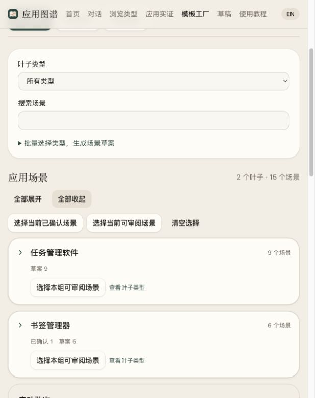
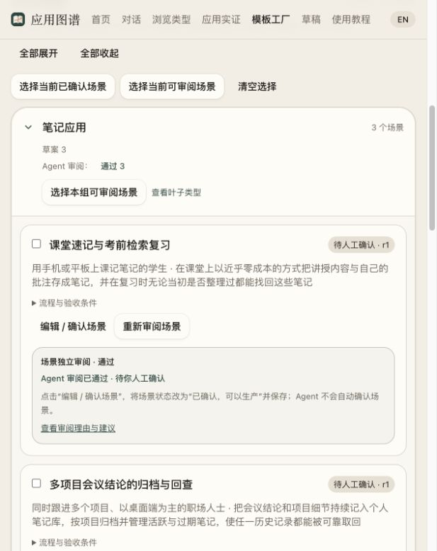
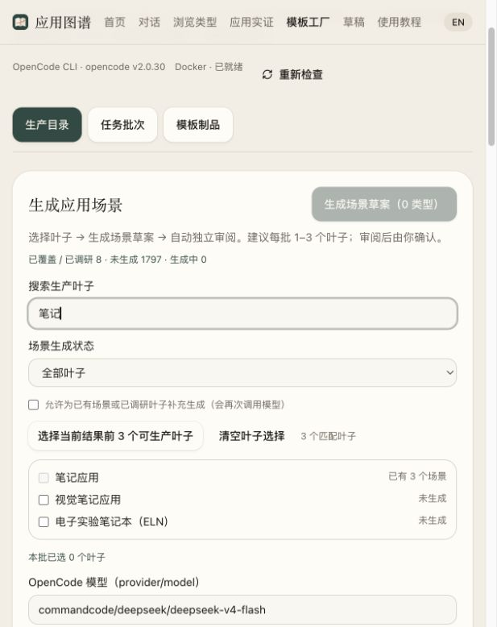

# 模板工厂验证记录

更新日期：2026-10-19。区分真实外部执行、模拟回归和暂未执行项目。

## 改造后书签真实端到端验证（2026-10-19）

已使用 `commandcode/deepseek/deepseek-v4.1-flash`，从已确认的“生活待购与灵感收藏夹”r2 重新生产完整认知库，导出 P0 执行包，再由 OpenCode 开发应用、独立 agent 验收、定点修复并复验。最终冻结套件 **10/10 用例、115 条断言通过**；独立浏览器核心流程及真实 Docker 重启后六组复查通过。模板保持 L0 / draft，未发布，P1/P2 未开发或执行。

初版虽通过冻结套件，额外独立审查仍发现 CRLF 跳转头注入和共享 SQLite 并发事务问题，真实 HTTP 探针复现后由模型仅修复三个源文件。冻结模板、用例与 delivery.json 保持不变；修复后危险 URL 返回 400 且不落库，20 轮并发未出现 500 或成功写入丢失。原始失败、验收工具纠偏、环境恢复和复验分别保留，不用模型自报替代行为证据。

完整过程、应用包、独立验收报告与用量见 [本次端到端记录](template-factory/end-to-end/bookmark-2026-10-19/README.md)。本轮实际调用 40 个模型会话，可见搜索 13 次、网页获取 3 次；这是包含失败与修复的单案例记录，不是常态费用或模板 A/B 收益证明。最终后端常规回归 434 项执行通过、8 项 opt-in 跳过；实际 Docker 结果另外记录。以下较早改造与历史测试的范围不变。

## 完整认知、阶段执行与独立验收（2026-10-19）

本轮导出、交付协议、CLI 进程可靠性和独立 Docker 运行改造见[实现与检查记录](template-factory/2026-10-19-factory-refactor/README.md)。真实容器覆盖 Python/Node Web、CLI 正负向、启动即退出、失败结果和超时清理；另有源码 ZIP 经 API 入队、版本固定、真实执行与验收落库的合成集成检查。后端常规检查和页面检查与实际容器结果分别记录。没有新付费模型调用，也不把运行器合成检查当成旧模板整套用例通过或模板收益证明。下文历史证据保留原范围。

## 场景独立审阅增量（2026-10-17）

已接入自动审阅和已有场景的单项/批量审阅。每个审阅使用新的 OpenCode CLI 会话，固定叶子正文、场景版本和同叶子的未归档场景。返回五项理由、原文引用、对照 ID、修改建议；结果仅供人工判断，不修改或确认场景。输入变更后旧结论标为过期。草案生成、审阅分别记录，审阅失败保留草案，可单独重试。

- 最终代码后端全量 **318 项**通过，其中工厂 **50 项**。新增覆盖自动排队、兄弟场景对照、生产/审阅并发槽独立、原子取消与重复排队、失败后单独重试、无效报告不记通过、场景/叶子/对照变更过期，以及 OpenCode 两代权限配置禁止审阅联网。
- 工厂浏览器 **7 项**通过，包括已有主线，以及草案直接批量送审、版本固定、待审按钮状态、修改建议、失败反馈、过期报告、英文和移动端。页面测试使用隔离库，worker 关闭；报告展示使用明确 fixture，不冒充真实 provider 审阅。
- 前端类型检查、生产构建、Ruff 和 diff 检查通过。以下较早记录中的前端 9 项单测与既有 17 项主线浏览器检查为 2026-10-16 的基线，本次没有重复执行。
- 真实 OpenCode `open-design/deepseek-v4.1-flash` 仅使用本轮自行编写的定义和场景，不外发新的 Atlas 叶子或用户项目。最终提示下：合格样例通过、几乎逐字重复的场景需修改、天气场景绑定任务类型被判为不建议采用；三项都保持 `draft`。报告引用及输出协议通过程序校验。
- 校准过程保留：初版对合格样例要求显式说明常规默认状态，误判为需修改。提示补充“只因影响用户流程或可观察验收的问题要求修改，不强求实现细节”，同输入复核通过；重复与错配样例也用最终提示重跑，仍识别出相应问题。共 6 次 CLI 调用，不能据此宣称大批量审阅准确率或费用基准。

机器记录见[独立场景审阅验证](template-factory/2026-10-17-scenario-review.json)。本增量交付时本地工厂保留原有 4 个场景，尚未送审真实目录项；API 已在无活动任务时重启加载增量，[实际页面](template-factory/2026-10-17-scenario-review-entry.jpg)可直接使用新入口。随后用户同意按每批 1–3 个叶子推进，首批结果如下。

## 首批真实场景生产（2026-10-17）

使用已授权的任务管理、书签管理两个叶子及 `open-design/deepseek-v4.1-flash`，生成并发 2。主批次 `bat_218ad08189cc42cd8ec4a77c08680df5` 自动创建 2 个生成任务和 6 个独立审阅任务，产出各 3 个场景。随后针对全文读取修复单独复核；主批次及复核批次最终全部完成。最终结果：**3 条审阅通过、3 条需要修改、0 条不建议采用**。所有新场景仍为 r1 草案，原有 4 个场景的状态/版本未改动，当前目录共 10 条；未确认新场景、未生产或发布新模板。

通过的三个草案为学生学期任务规划、独立研究者长期参考文献库、开发者项目技术资源索引。自由职业者周计划与已有个人周计划重叠，小团队共享清单与已有共享清单重叠，课程参考书架与研究者参考库的受众及流程重叠，三者需要进一步整理。这里的通过仅是模型审阅意见，仍需用户确认。

这轮保留并处理了两个协议失败：一条报告把区分度标为通过却填写实质重叠 ID，另一条返回的 JSON 缺少数组闭合符。均未计为有效审阅，失败原文保留；提示补充了“比较对象不等于重复对象”的说明，并单独重试，没有重新生成场景。

同时发现真实输入读取问题：完整叶子正文虽然在 `input.json` 中，但 JSON 字符串占一长行，OpenCode 的读取工具将该行截到约 2,000 字符。现在各阶段额外生成字节一致的 `leaf.md`，保留原始 JSON 正文及指纹，并授予精确文件读取权限。六个场景已按全文重新审阅；逐条日志核对可见任务管理全文 271 行、书签全文 229 行，所有行均有实际读取输出，文件 SHA-256 与固定输入指纹相同。早期部分正文的报告仍作为历史保留，不当作全文复核结果。

修复后后端全量 **319 项**、工厂 **51 项**、Ruff、diff 检查通过。两批合计 13 个不同任务、含两次失败重试共 15 次 CLI 调用；这个数量包含诊断后的全文复核，不作为稳定生产的费用或耗时基准。

首批识别出的产出改进项：生成阶段应固定已有场景作为对照，减少与既有草案重复；输出语言应显式随页面选择传入，本批任务管理的 3 条草案及报告为英文。当时生成输入仍只有叶子；这两项后续已实现并完成第二批验证，见下一节。不把审阅通过等同于批量产出质量已经稳定；新类型生产继续保持每批 1–3 个叶子的操作节奏。

完整记录与全文读取证据见[首批生产证据](template-factory/2026-10-17-scenario-batch-01.json)，[实际场景审阅页面](template-factory/2026-10-17-scenario-batch-01.jpg)展示研究者场景的草案状态与审阅结论。原始 CLI 事件、输入、失败响应和新旧审阅报告保存在本地工厂任务目录。

## 第二批回归：已有场景对照与固定输出语言（2026-10-17）

已实现 F8：生成任务在同一入队事务内固定同类型未归档场景的 ID、版本与用户目标/流程/验收内容，并记录摘要。生成和场景审阅使用批次的 `language`（`zh` / `en`，默认中文），界面切换不会暗改已有任务。允许模型返回零新增，但必须说明原因；数量、原因与新增场景 ID 原子保存，页面展示正常完成而非报错，零新增不创建审阅任务。旧任务没有目录快照时继续使用原固定输入，不补入可变目录。

真实批次 `bat_4c3d2984db65428fb55d1c17ebee0300` 继续使用已授权的任务管理、书签管理两个叶子及 `open-design/deepseek-v4.1-flash`、并发 2、明确中文输出。生成分别对照固定的 6 / 4 个既有场景，提出 3 / 2 个中文新增草案及说明，独立审阅最终为 **4 条通过、1 条需要修改**，本批没有被标为重复的场景。通过的草案为多视图任务一致性、单容器外部协作、跨浏览器多设备书签库、长期书签库整理；多渠道收件箱场景需补齐语音/快捷键捕捉的验收。所有新增仍为 r1 草案，原有 10 条的内容版本与确认状态未变，目录共 15 条；没有确认新场景或生产模板。本轮是两个已覆盖类型的回归，新增叶子覆盖为 0。

实际检查了两个生成输入及五个审阅的正文读取，七项均完整读到 `leaf.md` 文末，正文与固定指纹匹配；已有对照内容与入队快照摘要一致。所有新场景名称、目标、流程、验收、审阅说明和建议均为中文叙述，技术名称和源引用保留原样。这个结果证明当前中文路径实际可用，不构成所有模型或语言的合规保证。

两条书签审阅最初因逐字引用漏抄 Markdown 标记而失败。改为让模型返回原文起止行号，程序验证范围、从固定正文提取原文并显示行号，避免依赖模型复述字符串；原逐字引用协议仍兼容。仅重试两条失败审阅并保留原输出，两者均通过。共 7 个任务、含重试 9 次 CLI 调用，未静默接受无效引用。

最终后端全量 **324 项**、其中工厂 **56 项**通过；工厂浏览器 **8 项**、类型检查、生产构建、Ruff、diff 检查通过。新增覆盖了队列中已有场景和语言不随后续编辑变动、归档排除、零新增解释及无后续调用、无解释不能成功、输入语言校验、引用行范围与原文提取、中文/英文页面的固定输出语言展示。浏览器使用隔离 fixture，旧报告兼容展示也有检查。

真实 provider 本次提出了 5 个新增，未返回零条，因此零新增路径的证据仅来自本地后端与浏览器检查；不将其冒充真实模型行为。语义去重仍为限定输入上的模型辅助判断，人工确认继续保留。已有场景增加会使早期报告的对照上下文发生变化，页面可能将旧审阅标为过期，这是输入版本检查生效，不是旧场景被编辑。

详见[第二批机器记录](template-factory/2026-10-17-scenario-batch-02.json)及[实际批次页面](template-factory/2026-10-17-scenario-batch-02.jpg)。

## 真实生产与独立验收

使用 OpenCode CLI（当前制品登记时报告 **v2.0.30**；早期边界探针为 v2.0.26）与已配置模型 **open-design/deepseek-v4.1-flash**，来源为公开仓库 `dwyl/javascript-todo-list-tutorial`，固定 commit `547bbbf73528c6583f89bd27649d9ceb9bbc9660`，保留 GPL-2.0 LICENSE 原始哈希。

场景：个人用户添加待办、标记完成，刷新后任务与完成状态仍存在。

1. 初次试产改造了应用标题参数、明确的添加按钮、空白任务处理及 README。两个不同项目名的容器/浏览器行为检查通过。
2. 根据生产/验收分离要求，运行新链路生产修订版。生产注入了“任何调用运行验收均报错”的 verifier，任务仍成功完成，得到 **L0 候选且验收记录为空**，证明生产不依赖 Docker。
3. 随后独立创建运行验收和 Harness 审阅任务。运行验收通过；源码审阅第一次遇到 provider `ECONNRESET`，保留失败尝试。第二次因源码根目录提示不明确出现无效路径读取，主动撤销租约并保留中断记录。修复路径提示、提供必要源码证据后，第三次只读审阅通过。没有把失败尝试显示为通过。
4. 当前冻结修订版有源码审阅通过、运行验收通过两份独立记录，均绑定同一制品摘要；等级 L1，仍为未发布草案，没有代用户授予 L2 或发布。
5. 运行验收在两个全新目录分别渲染 `atlas-example` 与 `renamed-example`，使用固定镜像 ID 启动静态站点，浏览器实际输入 `Buy milk`、点击添加、勾选完成、刷新并检查任务与 `0 items left`。截图和浏览器 trace 保存在本地任务证据目录。

机器可读证据见 [真实试产摘要](template-factory/2026-10-16-pilot.json)。完整本地试产目录为 `/tmp/atlas-factory-live-20261016`；该目录不会纳入 Git，系统清理临时目录后需重新执行。

同一冻结制品经工厂实例化 API 连续创建两份 `my-task-board` 应用包：HTTP 201，两份 ZIP 字节完全一致，名称替换成功，LICENSE 哈希保持一致。该过程没有调用模型。示例包在 `/tmp/atlas-factory-application-example.zip`。

## CLI 工具边界实测

- 独立 Git 根和正确 `PWD` 修复后，CLI 成功读取隔离任务输入中的测试 nonce。
- shell 探针要求创建隔离测试文件；结果未创建该文件，CLI 报告 shell 不可用。该探针没有证明所有 CLI 版本的工具实现一致。
- 真实事件日志记录 `websearch` 工具 `status=completed`。这验证当前 provider/工具配置可以搜索，不代表全部 provider 支持搜索或搜索永久免费。
- 收紧后的源码审阅通过：关闭 glob/grep，提供明确的 `source/` 文件清单，仅允许任务输入和清理后的源码读取，不允许 edit/shell/插件/MCP/skill。
- 来源无明确许可证的另一候选被 `license_review_required` 拒绝，没有登记模板成功。

## 已授权双任务并发实测

用户明确授权将“任务管理、书签管理”两个叶子的资料发送给 `open-design/deepseek-v4.1-flash` 后，使用真实持久 worker 在隔离测试库执行，OpenCode 报告版本为 v2.0.30。

- 批次：`bat_70c6ed193b5a499c8d2a657875123b73`，类型为场景草案生成，配置并发 2。
- 实际观察到 2 个运行中任务和 2 个同时活动的独立 CLI 进程记录；两个会话 ID 不同。由结束时间与持续时间估算，CLI 进程运行区间重叠约 34.88 秒。
- 两项均首次成功，CLI 退出码为 0，批次持久化状态为 `completed`；整体观察耗时约 51 秒。CLI 调用分别约 35 秒和 49 秒。
- 任务管理生成 3 个草案：个人周计划工作台、小组共享清单协作、周期性事务复位；书签管理生成 1 个草案：生活待购与灵感收藏夹。
- 重新建立数据库连接后，4 个草案的流程、验收条件、版本与 `draft` 状态完整保留；没有自动确认场景，没有产生或发布模板，也没有写入正式工厂目录。
- 两个 CLI 的进程记录均已结束。本次验证的是双任务场景草案生成及持久化，不能据此推断大批量模板生产吞吐或费用。

机器可读证据：[双任务并发结果](template-factory/2026-10-16-concurrency.json)。完整输入与运行日志保留在证据 JSON 的 `workspace` 指向的本地临时目录；摘要已写入仓库，临时目录可能被系统清理。

## 自动化检查

- 后端全量 **309 项通过**，其中工厂 **41 项**。覆盖场景 CAS、固定输入、并发领取、暂停/取消、租约/恢复/迟到结果、检查点复用、参数渲染、篡改检测、路径/归档/许可证、真实子进程 JSONL/取消协议、生产不调用 Docker、独立调度、审阅/环境失败、修订、发布和叶子过滤。
- 前端单测 **9 项通过**；TypeScript 检查和生产构建通过。
- 工厂 Playwright **5 项通过**：真实隔离 API 的场景保存/批次取消与持久化、叶子场景入口；移动端/英文/空态/错误反馈；候选源码审阅与运行验收的区分；叶子已发布模板创建应用。模型调用、制品卡片场景及部分失败响应使用明确 fixture，不计为真实 provider 执行证据。
- Ruff 与 `git diff --check` 通过。
- 现有浏览器主线回归 **17 项通过**，包括类型浏览、草稿生成/轮询、移动端、双语、项目状态及备份恢复；与工厂 5 项合计 **22 项浏览器测试通过**。

全量后端检查最初与会写仓库内临时目录的浏览器检查并行，触发既有源码变更保护测试；串行重跑全部 305 项通过。旧浏览器测试还硬编码了默认 API 地址与夹具目录；最终回归使用临时副本统一改到隔离端口/目录，不修改原测试断言。

可重复命令：

```sh
python3 -m unittest discover -s application-atlas-production-pack/tests -q
python3 -m ruff check application-atlas-production-pack/template_factory application-atlas-production-pack/tests/test_template_factory.py
cd atlas-web
npm run typecheck
npm test
npm run build
npx playwright test --config playwright.factory.config.ts
```

不要将会修改仓库目录的检查与源码变更保护测试并行。

## 未覆盖范围

- 真实并发已覆盖两个场景草案任务；未进行大批量模板生产吞吐、长时间稳定性或费用基准测试。
- 真实运行验收覆盖静态待办与 Node 构建书签两个案例；Python Web/CLI 仍以协议与失败处理回归为主，不宣称全部配置、所有叶子或跨平台均已实测。
- Docker 默认 bridge 网络；不宣称出站隔离或全面供应链安全认证。模型审阅范围也不等同完整产品/安全认证。
- 没有获得精确 provider 费用或大规模成功率数据，不报告估算为实测。


## 场景接入与来源预检（历史准备）

用户继续推进后，将隔离测试的 4 个场景整理到实际本地工厂目录，均保持 `draft`，未启动生产。原始测试库和并发证据没有修改。目录记录、源场景映射和逐项改动见[场景审阅与目录记录](template-factory/2026-10-16-scenario-catalog.json)。

人工整理去掉了模型自行限定的小团队人数、禁止中间状态及固定七天后的泛化；子任务改为验证进度一致性，并为周计划补充了持久化条件。周期任务按配置日历规则生成，月末不存在日期的处理须明示。这些是待用户审阅的草案，不表示已经确认业务决定。

建议先试产“生活待购与灵感收藏夹”：保存链接、归类/移动、搜索、重新进入保留、打开原网页。个人周计划作为下一例；共享协作与周期调度之后再决定。

已读取公开来源并完成静态准备：

- 首选候选：[LakhindarPal/bookmark-manager](https://github.com/LakhindarPal/bookmark-manager)。README 描述本地 IndexedDB、标签和检索；元数据报告 MIT，源码 LICENSE 已获取并记录哈希。预检 commit 为 `539881bc67099d491e8ab6f85de0f443fa7de623`，20 个文件，未执行候选代码。原项目使用 Bun、Ripple 和 Vite，不能据此宣称 Node/npm 启动已通过。
- 周计划候选：[chrisvel/tududi](https://github.com/chrisvel/tududi)。README 列出日期视图、子任务和重复任务；当前仓库元数据报告 MIT。作为后续候选，尚未下载、改造成模板或运行。
- 未选 [Bookmrk](https://github.com/sarvan-2187/Bookmrk) 作为此次普通 Web 模板起点：当前 README 已说明迁移至浏览器扩展及 `chrome.storage.local`，搜索摘要中的旧 Vite/Web 描述不能代替当前源码判断。

[来源预检记录](template-factory/2026-10-16-source-preflight.json)保留当前 commit、构建脚本和来源声明。准备阶段的工厂页面已填入书签场景、模型及候选仓库，场景当时仍为草案。之后用户明确确认该场景，r2 转为可生产状态；另外三个导入场景仍保持草案。

此前准备阶段未执行新的模型调用。用户随后明确确认书签场景，并授权模板试产、必要修复及独立 Harness 审阅，结果继续记录如下。

## 书签场景真实试产：完成，未发布

用户明确确认“生活待购与灵感收藏夹”场景 r2，并授权将书签叶子正文、场景、公开来源、模板及必要修复证据交给 `open-design/deepseek-v4.1-flash`。来源为 [LakhindarPal/bookmark-manager](https://github.com/LakhindarPal/bookmark-manager)，实际获取 commit 与预检一致：`539881bc67099d491e8ab6f85de0f443fa7de623`。MIT LICENSE 哈希保持 `17e5ccdd3ca04fa001985e8b3370d70d357f858d491b5691a461fd5985834a44`。

最终制品：`tpl_1218aec42a064629a0e66dd1f44da891`，摘要 `91ce1f32d0d950c64ec301ca26505475ebd5395f65b0bf3524eb267e2a9af6df`，**L1、未发布草案**。没有授予 L2/L3 或自动发布。

- **正式运行验收通过**：`atlas-example` 与 `renamed-example` 在两个全新目录分别安装 52 个依赖包、构建、启动，每组执行 50 项浏览器操作/断言。两组均通过；镜像固定为记录中的 Node 22 Linux image ID。覆盖保存两条书签、刷新保留、打开保存 URL 的真实导航请求、移除旧分类并保存新分类、再次刷新、分类浏览与关键字检索。
- **独立 Harness 源码审阅通过**：另一只读 OpenCode 会话逐项审阅四个固定验收条件，引用实际源码文件，结论为审阅范围内未发现阻断问题；没有声称自己执行了应用。审阅与运行结果绑定同一制品摘要。
- **真实浏览器补充验证通过**：使用第一组正式构建的只读静态预览，保存不填分类的书签，观察成功反馈与默认 `inbox`；关闭标签页，再打开同一地址，记录、URL 和分类仍保留。仅测试关闭重开标签页，没有宣称操作系统或浏览器进程完全重启。临时预览容器和标签页已清理，[页面证据](template-factory/2026-10-16-bookmark-reopen.jpg)保留。
- **应用包实例化通过**：两次生成 `my-bookmark-library`，ZIP 字节完全一致，四个参数文件名称替换完整，MIT LICENSE 哈希不变。此操作没有调用模型或在宿主安装启动应用。本地示例应用包 `/tmp/atlas-bookmark-library-final-candidate.zip` SHA-256 为 `3865ea084b3f500baf54d12f932d0743770e0f5250ac51d79d7c812c72311cd4`。

试产保留了五个冻结版本，而非覆盖失败版本。依次发现并修复：

1. 计划选择 Python 容器却执行 npm，正式验收返回找不到可执行文件；改用 Node 配置。
2. 候选构建时，Ripple 转译后残留可选函数参数的 `?`；分别将 `showToast` 与 `commitCategories` 改为显式默认参数。
3. 菜单选择器匹配多条记录及隐藏按钮；改为按具体记录定位。修改分类后等待“Bookmark updated”反馈，再刷新。
4. 新增书签先更新界面、后写入 IndexedDB，正式全新安装时出现刷新丢失第二条记录的竞态；最终版本先完成持久化写入，再显示记录。之后两组正式验收通过。

首版审阅和一次源码修复遭遇 provider `ECONNRESET`，保留不可用/失败记录；另一次旧候选审阅在构建阻断确定后取消，没有将其记为通过。重试复用固定源码、场景与已完成计划；诊断复用依赖的结果明确不算正式验收。

本轮同时补齐工厂机制：

- 校验运行配置是否提供计划中的命令，避免 Python/Node 环境混用。
- 源码修复默认复用冻结计划并跳过计划模型调用；只有显式勾选才修订技术检查，业务场景与条件保持原版本。
- 支持精确文本替换：旧文本须唯一匹配，缺失/重复、覆盖冲突或许可证修改均失败。真实修复仅返回局部替换，没有重复输出整个文件。
- `open_link` 断言点击后的实际导航目标，外部响应仍被阻断；正确目标通过、错误目标失败均已实测。该证据不代表外部网站可用。

本轮后端全量 **309 项**、工厂 **41 项**、工厂浏览器回归 **5 项**、前端类型检查和生产构建、Ruff、diff 检查通过。一次既有回读测试最初扫描了正在写入的真实仓库而触发保护；现改用自身临时源码目录，生产源码保护逻辑未放宽。

完整机器可读记录见[书签试产](template-factory/2026-10-16-bookmark-pilot.json)。测试覆盖记录中的 Linux 容器与浏览器环境，不作跨平台或全面安全认证；provider 实际账单不可用，不报告估算费用。

[实际工厂结果截图](template-factory/2026-10-16-bookmark-factory.jpg)显示最终 L1 草案与两项通过的独立验收。临时示例 ZIP 可能被系统清理；持久制品在本地工厂数据目录，可通过“创建应用包”重新导出。


## 2026-10-17：生产目录按叶子分组

场景目录由平铺卡片改为“叶子类型 → 应用场景”。组头显示总数、各场景状态数量及已选数，可分别展开收起或全部展开收起；单叶子和搜索结果默认展开。分组选择与全局选择均保留其他叶子的已有勾选，搜索范围外的选择单独提示，归档场景不加入可审阅选择。未修改任何场景内容、确认状态或生产任务。

验证：TypeScript 类型检查和前端构建通过；工厂浏览器回归 9 项通过，补充的分组测试验证跨组勾选、收起保留、轮询刷新保留展开状态、搜索后隐藏选择提示、筛选内追加选择、单组清除、归档禁用、英文与 375px 移动端。最后追加选择行为修改后，该分组测试再次通过。本轮未调用模型。

实际目录为任务管理软件 9 个、书签管理器 6 个，共 15 个场景。在现有页面实测选择两组、搜索“生活待购”后仍保留全部 15 个选择，并提示 14 个不在当前筛选范围；已清空临时选择、恢复收起的目录视图。




## 2026-10-17：第三批场景生产（新增叶子覆盖）

用户明确授权后，批次 `bat_e0bb94d1119548b795197d661d199850` 使用 `open-design/deepseek-v4.1-flash`、中文输出、生成并发 2，对笔记应用、日历应用、预算应用三个尚无场景的叶子生产。每个生成输入固定零条已有场景，分别产出 3 个草案；9 个草案均自动进入独立审阅。全部 12 个任务最终完成。

| 叶子 | 新增草案 | 审阅通过 | 需要修改 |
| --- | ---: | ---: | ---: |
| 笔记应用 | 3 | 3 | 0 |
| 日历应用 | 3 | 2 | 1 |
| 预算应用 | 3 | 2 | 1 |
| 合计 | 9 | 7 | 2 |

需要修改的两项：多人会议场景缺少对候选时段忙闲与冲突的可观察验收；一次性项目预算场景的总上限、分配合计和实际金额口径需消除歧义。详细建议保留在各场景审阅报告中，尚未代替用户编辑或确认。模型提出的其他建议仍属建议，不自动增加产品要求。

恢复记录：一条日历审阅首次返回的五个 `reason` 皆为空，严格校验拒绝该报告，未将其记为通过。仅重试该审阅的固定输入，第二次完成且结论通过；没有重新生成场景。本批共 13 次 CLI 调用（3 次生成、9 次审阅、1 次审阅重试），不含实际账单费用测量。所有阶段 `leaf.md` 与对应固定正文逐字一致，CLI 退出码均为 0；CLI 正常退出与报告协议合格分别核对，不混淆。

目录由 2 个已覆盖叶子 / 15 个场景增至 **5 个叶子 / 24 个场景**。原有 15 个场景的内容、版本和状态均未变化；新增 9 个全部保留为 r1 草案。未确认、归档或修改场景，未生产或发布模板。审阅结论仅针对固定输入，不代表实际运行、市场价值或全库去重已经验证。本轮只执行生产及结果核对，没有修改代码或重跑代码测试。

[第三批机器记录](template-factory/2026-10-17-scenario-batch-03.json) · [实际批次页面](template-factory/2026-10-17-scenario-batch-03.jpg)。


## 2026-10-17：区分审阅结论与人工确认

针对“发起审阅是否重复执行、为何通过后还是草案”的使用反馈，前端增加两条独立状态的说明，分组显示 Agent 审阅结果数量，通过草案卡片显示“待人工确认”并提供具体确认路径。按钮区分首次、再次、失败重试、排队及运行；过期结论不计入通过数量，失败不会当作通过。未自动确认或修改真实目录，也未调用模型。

工厂浏览器回归 **10 项通过**，新增测试覆盖首次 / 再次 / 失败 / 排队 / 运行按钮、过期结论汇总、通过草案仍不能生产、明确人工确认后才可生产，以及中英文与 375px 移动端。确认动作使用隔离 fixture 验证，不修改真实笔记场景。TypeScript 类型检查、前端构建及 diff 检查通过。




## 2026-10-17：单叶子场景生产用量实测

使用第三批三个叶子的真实会话统计，范围为“每叶子生成 3 个草案 + 每草案一次独立审阅”，并计入日历的一次审阅重试：

| 叶子 | 生成 token 字段加总 | 独立审阅（含重试） | 合计 | 其中缓存读取 | 联网搜索 / 网页获取 |
| --- | ---: | ---: | ---: | ---: | --- |
| 笔记应用 | 16,535 | 54,138 | 70,673 | 21,760 | 0 / 0 |
| 日历应用 | 13,698 | 71,427 | 85,125 | 32,512 | 0 / 0 |
| 预算应用 | 18,837 | 59,884 | 78,721 | 25,984 | 0 / 0 |

合计 234,519，平均每叶子 78,173。这里的观察口径为 OpenCode 各 assistant 消息 `input + output + reasoning + cache.read + cache.write` 字段累加，包含多轮重复上下文、缓存和重试，不等同于 provider 账单中的统一单价 token。去掉缓存读取字段后，每叶子的其余字段合计约 4.9–5.3 万；不同类别需按 provider 对应计价，不能拿总量直接乘统一价格。导出的 `cost: 0` 不作为免费证据，本轮未读取 provider 账单。

发现 CLI 流日志在这些会话中遗漏最后回答回合的 `step_finish`，直接累加流事件会低估。因此只读导出 13 个本地脱敏会话，从逐消息用量汇总，确认均包含最后 `finish: stop`；日历生成工作区的 `opencode stats` 与逐消息统计一致。本版本会话 `info.tokens` 与逐消息统计不同，本记录采用与 stats 相同的逐消息口径。完整导出仅留在本地临时目录，纳入文档的记录仅含用量元数据。

13 次调用的可见工具均为本地 `read`，`websearch` 与 `webfetch` 均为零。场景生产当前使用 Atlas 正文，无需每次联网；此结果不适用于模板选源、源码改造和验收，也不代表能够观测 provider 内部所有活动。

[逐叶子、逐阶段和逐调用用量记录](template-factory/2026-10-17-scenario-usage.json)。


## 2026-10-17：第四批场景生产与六叶子用量汇总

批次 `bat_9b1baf7a92a5489e9e597dd70d9110d2` 使用已授权的 `open-design/deepseek-v4.1-flash`、中文、生成并发 2，处理待办事项、稍后阅读、时间跟踪三个未覆盖叶子。每叶子新增 3 个草案，全部独立审阅；12 个任务最终完成。

| 叶子 | 草案 | 审阅通过 | 需要修改 |
| --- | ---: | ---: | ---: |
| 待办事项应用 | 3 | 2 | 1 |
| 稍后阅读应用 | 3 | 2 | 1 |
| 时间跟踪应用 | 3 | 3 | 0 |

需修改项为家庭共享采购清单（参与人数与购物结束表述）和旧阅读服务迁移（导入完整性与归档/副本验收）。一条时间跟踪审阅首次未提供任何正文行号或逐字引用，被拒绝而非记为通过；仅重试该审阅，第二次完成并通过。总计 13 次 CLI 调用。全部阶段 `leaf.md` 与固定输入正文一致，最后 CLI 均正常退出，协议校验与审阅结论分别核对。

目录由 5 个叶子 / 24 个场景增至 **8 个叶子 / 33 个场景**，原有 24 个场景内容、版本、状态未变化；新增 9 个均为 r1 草案，没有自动确认、修订或生成模板。本轮无代码修改，不重复运行代码回归。

[第四批机器记录](template-factory/2026-10-17-scenario-batch-04.json) · [实际批次页面](template-factory/2026-10-17-scenario-batch-04.jpg)。

第三、四批的 26 个完整本地会话合并后，共 6 个叶子、18 个新场景：

| 叶子 | 生成 token 字段加总 | 审阅（含必要重试） | 合计 | 联网搜索 |
| --- | ---: | ---: | ---: | ---: |
| 笔记应用 | 16,535 | 54,138 | 70,673 | 0 |
| 日历应用 | 13,698 | 71,427 | 85,125 | 0 |
| 预算应用 | 18,837 | 59,884 | 78,721 | 0 |
| 待办事项应用 | 16,126 | 54,814 | 70,940 | 0 |
| 稍后阅读应用 | 13,536 | 49,995 | 63,531 | 0 |
| 时间跟踪应用 | 15,310 | 67,437 | 82,747 | 0 |

采用上一节相同的完整逐消息、含缓存与推理的观察口径：合计 **451,737**，平均每叶子 **75,290**（生成约 15,674、审阅约 59,616）；每叶子区间约 **6.4–8.5 万**，每条场景平均约 25,097。搜索及网页获取可见调用均为零。该样本包含两次审阅重试，仅代表当前每叶子三个新草案的场景流程，不代表模板源码生产费用；缓存、推理及不同输入输出的账单价格不能合并为统一单价。机器记录已扩充为包含两批逐调用字段的[用量记录](template-factory/2026-10-17-scenario-usage.json)，完整会话仅保留在本地临时目录。


## 2026-10-17：生成入口与叶子覆盖防重复

用户反馈已有场景的叶子无法区分、生成入口藏在长列表之后。现将场景生成独立为生产目录顶部区域，按钮直接置于标题旁，展示已覆盖/已调研、未生成、生成中数量。生产叶子搜索与下方场景搜索互不影响。默认未生成筛选；列表标记已有场景数量（包括归档）及已完成调研但零新增状态，补充生成需显式选择，排队/运行叶子始终不可选。筛选外选择保留，轮询造成失效的选择不进入请求并提示原因。

API 新增可选 `skip_generated` 布尔参数。前端默认传 true；服务器在创建批次的同一写事务里检查已有场景、完成的场景调研及排队/运行任务。已覆盖返回 `scenario_already_generated`，重复排队返回 `scenario_generation_active`（409），不创建部分批次。显式补充可绕过已覆盖检查，但不能重复排队。旧调用省略该参数保留补充生成兼容行为。零新增仍是正常完成，其历史阻止默认重复生成，不等于已经覆盖该叶子的所有使用场景。

验证：后端全量 **327 项通过**，工厂 **59 项**，新增覆盖归档场景、完成零新增、显式补充、并发请求只入队一次、暂停队列仍阻止重复、取消后可新建及参数类型校验。工厂浏览器 **11 项通过**，新增覆盖默认筛选、标记、零新增、正在生成不可选、独立审阅任务不误当作生成任务、显式补充开关、跨筛选选择、提交参数及中英文移动端。TypeScript、生产构建、Ruff、diff 检查通过。所有测试均使用临时库或 fixture，不调用 provider。

实际页面核对：生产记录显示已覆盖/已调研 8、未生成 1797、生成中 0；搜索笔记时，默认未生成列表不出现笔记应用，切换全部后显示“已有 3 个场景”且不可选。页面已恢复默认未生成筛选。本地 API 在确认无活动任务后重载，目录仍为 33 个场景、8 个叶子；本轮没有生成、确认或修改真实场景。




## 2026-10-19 跨品类认知模板与交接形式对照

预算、设施预约、批量改名各比较无模板、完整附件、同包分层按需，共九个初版条件；八组完成规范交付，预算完整组两次文件清单前缀协议错误未交付，未执行失败源码。预约三组、预算无模板、改名三组的共同核心实际通过；预算分层首版真实启动失败，经一次 OpenCode 修复后核心及浏览器通过。

独立 Agent 在改名无模板源码中发现风险后、读取另两组前冻结 EP01，并对三组统一实测：无模板首版确实在测试自有的根外目录创建新回执，两种模板未出现此问题；没有覆盖已有哨兵的证据。无模板经一次 OpenCode 修复，核心及同一 EP01 通过。EP01 为事后探索，不追改 F01–F11，不作安全认证或普遍收益结论。

模型统一 commandcode/deepseek/deepseek-v4.1-flash、high。两模板的输入包字节相同；独立运行与结果审阅不提供条件映射，原文档仍可能暴露来源。预算原四次调用附入了同一段 622 字符宿主脚本，偏差及实际会话核对保留；改名和修复显式隔离 stdin。v2 首个预约运行的工具故障保留，当前统一使用 v3。改名首版扩展审阅两次缺 exploratory 字段，严格协议失败保留；核心/认知子集原文与最终轮次完整审阅分别记录，未补造字段或第三次调用。

全部真实服务、浏览器、代理与 CLI 子进程已清理，应用源码未手改；实际哈希、调用、可见用量缺失及复测见[完整报告](template-factory/ab-tests/cross-domain-2026-10-19/REPORT.md)。三份认知模板静态审阅通过，但自带程序未整套执行、未发布或晋级，旧书签 17 项验收待办不变。[形式分析](template-factory/ab-tests/cross-domain-2026-10-19/FORM_ANALYSIS.md)是待实现建议，不代表已改造通用工厂。
