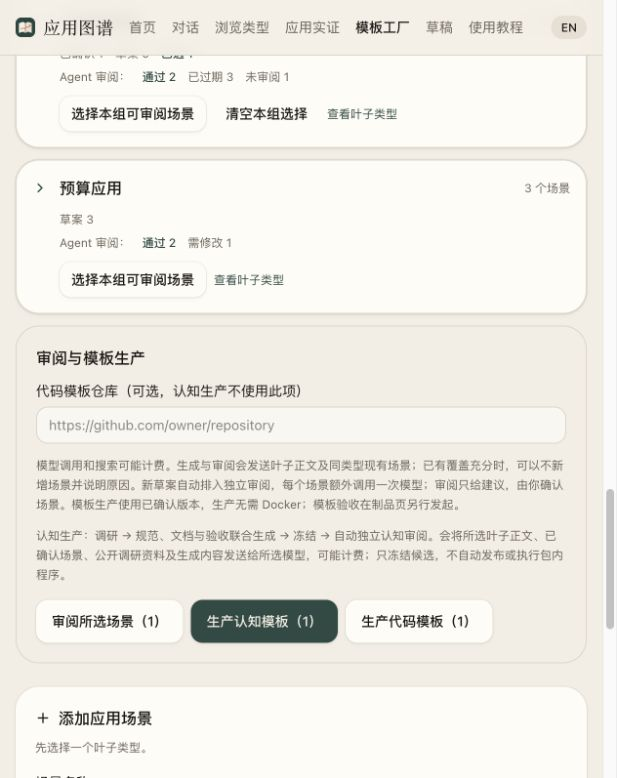
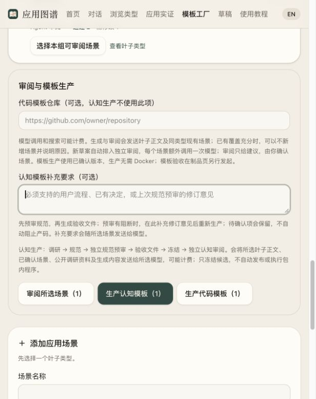

# 自动认知模板生产与独立审阅

2026-10-17 启动，2026-10-18 更新。范围为已确认场景的认知模板生产、静态审阅与修订；旧代码模板链路保留。

## 当前结论

工厂通路已具备研究、规范预审、逐文件产出、冻结、独立完整审阅、定点修订与页面交接。**自动书签候选 v0.1.12 已通过八项独立认知静态审阅，完成本轮静态收口；下一步是 P0 真实试用。** 主流程、架构/表单一致性、生命周期、UI验收语义、异步调用、模块接口和服务器确认负例均已修订并核对，见[收口记录](cognition-pilots/bookmark-2026-10-17/closure-2026-10-18.md)与[最终原始报告](cognition-pilots/bookmark-2026-10-17/review-12.json)。当前仍 L0/draft、未发布，没有运行下游应用；旧手工样板的 P0 成绩不适用于本自动包，暂不扩大批量。

因此先将规范审阅前移，减少在不完整规范上继续堆验收代码：初次生产和规范修订先预审五项设计，再有限修订；明确阻断仍存在则不产码，待确认项仅保留。页面增加生产补充要求和预审意见。固定规范的程序修复可复用规范，仅调用选中文件，仍另做完整审阅。

## 实现

- 新生产类型 `blueprint-production`：固定叶子、确认场景版本、输出语言、provider/model 与配置；写事务内防止同场景并行重复生产。
- OpenCode 多源调研 → 检查点 → 规范与验收程序分阶段联合生产（先规范与文件计划，再按文件生成，整包校验）。Atlas 控制 ID、场景、来源、主文档、AGENT.md、阶段验收计划与完整性清单；模型仅输出声明字段和验收/参考文件。
- 生成结果经结构、引用、双向阶段/能力/用例映射与文件哈希校验后冻结；未执行生成程序；生产包的阶段与验收执行状态由 Atlas 固定为未实现/未运行，不采纳模型自报通过。结构修复读取实际错误及上一份提案，有限重试，保留尝试。规范与每个文件分别持久化检查点，失败后复用已完成部分。模型触及输出长度上限会立即失败，不接收半份 JSON，也不继续消耗自动续写调用。
- 自动创建 `cognitive-review`，复用独立验收调度通道，另开只读模型会话。完整核对八维度及文件引用，整体结果由分项推导。provider/协议失败保留未完成记录，制品页显示安全错误和重试入口。
- 认知审阅不联网、不执行、不安装；联合生成也不开放搜索。研究可 websearch；webfetch 仍只允许已有四个官方/源码域名，其他官网可用搜索但全文证据不足必须保留未知。
- 页面支持独立审阅、重新审阅、失败重试、意见驱动的新冻结修订。修订复用原场景与研究，原制品不覆盖。
- 认知审阅不套用旧 L1 晋级，不自动发布；没有用模型自评替代真实应用验收。

## 本地验证

- 后端全量 `python3 -m unittest discover -s application-atlas-production-pack/tests -q`：374 项通过（最新复核于 2026-10-18）；覆盖分项预审恢复、固定材料摘要、精确规范补丁、版本锁定字段替换、引用路径规范化及严格信封恢复。预审阶段的 OpenCode v1/v2 禁搜/只读权限另经定点检查。
- 工厂 Playwright 独立测试：17 项通过，包括导入/阅读/开发包、草案禁产、固定版本、独立审阅、取消/重试、保留旧版，以及规范阻断理由与生产补充要求。浏览器测试使用隔离库和假 provider，不作为真实模型质量证据。
- `npm run typecheck`、`npm run build`、工厂模块及相关测试 Ruff：通过。
- 实际本地 API 5199 已重新启动；主目录仍为 8 叶子 / 33 场景。CUA 核对确认场景可选、“生产认知模板（1）”、独立审阅和修订入口，未通过界面额外触发重复模型调用。

## 本次真实模型验证

用户明确授权仅书签叶子、“生活待购与灵感收藏夹”确认场景、公开调研、生成认知包及必要失败意见发送至 `open-design/deepseek-v4.1-flash`，用于本次生产、修复和独立审阅，不发布。授权与可复现驱动保存在 [试产目录](cognition-pilots/bookmark-2026-10-17/)。

调研上下文已改为可分页读取的 Markdown 软换行，避免 JSON 中的长中文字符串被读取工具按行截断；来源原始内容与摘要仍以固定研究记录为准。

首次调研实际输入缺少 `research_date`，模型把此项记录为未知并使用会话日期；后续代码已补传实际日期，并增加输入检查。首次调研还出现重复尝试受限域名；后续提示明确现有读取范围与不足记录，不扩大权限。启动时的代码哈希保存在试产根目录的 pilot-scope.json，后续提示修复不冒充该首次调用已经使用。

模型任务运行于独立工厂根目录 `application-atlas-production-pack/atlas/template-factory/cognition-pilots/bookmark-2026-10-17/`。实际输入、事件、研究检查点、提案、制品、审阅报告和失败尝试保留于该忽略目录，避免把配置或无关原始流日志带入文档。

格式解析仍要求完整对象，不会从截断的外层对象中捞取一个嵌套小对象冒充结果；认知阶段可移除字符串之外的多余闭合符，仍必须能完整解码且通过阶段协议；不添加缺失括号、字段或值，不改写代码字符串，其他尾部内容继续拒绝，校正有原始摘要和位置凭据。

首次整包单次输出在约 1.6 万输出 token 时被 provider 截断（`step_finish.reason=length`），没有创建制品；已保留失败尝试和研究检查点。改为规范/文件计划与逐文件生产后，第二次得到完整规范与 7 个文件计划，但多一个终止 `}`。第三次按精确外层格式修复复用该完整对象，原始文本哈希、规范摘要和代码版本保存在 [校正记录](cognition-pilots/bookmark-2026-10-17/spec-framing-recovery.json)，未修改规范字段、未额外调用规范生成。逐版结果见后文与最终汇总；不能用旧手工样板的十项 P0 成绩替代本自动产物。

## 仍未完成

认知包发布与等级、在线项目决策编辑、通用下游应用运行验收、第二品类真实试用和大规模质量评估。当前队列可以多场景受控并发生产候选；是否适合扩大仍取决于真实审阅及下游试用。

## 首版审阅与修订

首个自动候选 v0.1.0 已冻结：25 项能力、8 个决策、3 阶段、23 项验收；五个 CJS 程序的静态语法检查通过，应用验收未运行。独立会话给出架构契约与阶段验收阻断，其他六维度在静态范围内通过。原报告末尾有一个多余 `]`，初始调用保留为 unavailable；严格删除多余闭合符并校验全部八维度及文件引用后，复用同一真实会话登记为 blocked，不额外请求模型、也不修改意见。详见 [原意见及校正凭据](cognition-pilots/bookmark-2026-10-17/review-1-recovery.json)。

修订范围见 [问题与修订要求](cognition-pilots/bookmark-2026-10-17/REPAIR_NOTES.md)。新增受摘要保护的未改文件复用、精确唯一文本替换及补丁版本号递增；不覆盖首版。首次修订被人工中止，以补充完整修订意见/审阅 Markdown 伴随文件；后续测量原意见为 1,681 字符，**没有确认该次已发生截断**，这一中止属于预防性传输改进，不能归为 provider 故障。长意见伴随文件经本地检查覆盖，后续尝试复用原研究。

格式恢复的人工重放基于工厂**已脱敏的留存事件文本**；摘要对应该留存版本，不宣称是脱敏前原始字节。首版规范的 Authorization 示例含一个脱敏占位符，保持遮盖，不恢复任何凭据；support 代码没有脱敏标记，语法检查通过。后续 CLI 内置格式校正在落盘脱敏之前处理完整回答，并独立保留校正摘要。

修订的 support 文件曾返回完整 JSON 后附 DeepSeek DSML 结束标记，严格解析拒绝后已按已知结束标记白名单恢复；不执行或解释其中工具指令、不接收任意尾部文本、不修改代码字符串。详见 [凭据](cognition-pilots/bookmark-2026-10-17/support-framing-recovery.json)。

修订计划中 F06 在 P0 交付，并由 P0 A03 验收，P1 A13 移动归类时再次验证单一归属。这是合理的累计回归，不应由旧的“用例阶段必须等于所有关联能力阶段”规则拒绝。校验已改为允许后期回归早期能力，同时禁止反向依赖，并要求首次交付阶段存在基线验收；两个方向与漏基线均有回归检查。正在运行的旧进程保留全部文件检查点后重载新校验，不修改模型规范来迁就校验器。

## 修订版冻结

v0.1.1 已冻结为 `tpl_623e0336b49144fd8a4836c5cb59691d`，摘要 `0c57c66c4fb57c6dd87746acde018cc2f411978ac446c3b1074c38c366d5a3f9`：25 项能力、9 个决策、33 项验收，20 个验收文件，其中 18 个 CJS 全部通过 `node --check`。没有执行目标应用、重启适配器或浏览器验收，也没有安装依赖。

已完成文件检查点在校验器重载后全部复用。`acceptance/package.json` 的缺逗号缺陷触发单文件修复；真实模型给出的精确替换仅补一个逗号，原无效响应、错误和修复检查点均保留。新增导入/冻结依赖清单语法及字段类型检查，未把清单解析成功冒充依赖安装成功。

修订版独立会话 `job_683650aada974fb79d072884b6b3f457` 已完成：六维度通过，架构契约 uncertain，阶段验收 blocked，详见 [复审报告](cognition-pilots/bookmark-2026-10-17/review-2.json)。剩余问题集中在空白标题/非法归类等契约歧义、删除的高风险负例，以及浏览器导航丢失部署路径前缀。候选保持 L0 / draft，未发布。

第二轮按 [窄修订要求](cognition-pilots/bookmark-2026-10-17/REPAIR_2_NOTES.md) 继续，保持 25 个能力、9 个决策、33 个验收 ID 与阶段，不因可选建议扩张新能力。工厂同时修正研究复用：新包保存主机所有的结构化研究；历史自动产物沿同场景、同来源的冻结修订链寻找原研究检查点，校验检查点与来源摘要后复用，避免重复拼接 CATEGORY。缺少原结构记录的历史导入包仍明确保留未知，不伪造研究事实或刷新日期。AGENT 指引补上 proposed 决策处理、阶段选择和真实验收证据记录。

第二轮首尝试在 `acceptance/ui-p0.cjs` 的精确补丁校验处失败，未登记新制品。已完成的 14 个文件检查点保留；恢复只重试失败和后续文件，不重新研究或生成规范。单文件补丁校验错误会把替换编号与实际匹配次数反馈给模型，按任务的有限修复次数重新生成该文件；仍失败则任务失败，不模糊匹配、不吞掉错误。恢复和耗尽次数均有本地回归。2026-10-18 实际页面入口再次复核，见[截图](2026-10-18-cognitive-production-entry.png)。

v0.1.2 已冻结为 `tpl_b039c0f308694b93ba0a4873fe774591`，摘要 `d1d440d9bf3fc795edb9114ee62c9da5b67eb71a971dd381b3258447ec85c5ab`。仍为 25 项能力 / 9 个决策 / 33 个验收，18 个 CJS 语法检查通过；CATEGORY 中 S02 来源段仅一份，原研究未知项完整保留。恢复时重复补丁再次失败，有限单文件修复成功，所有事件保留；独立复审为另一个会话 `job_4951e6356c7c46ec9e9417676eaaaed5`。

人工静态检查补充发现 browser.newContext 的全局 extraHTTPHeaders 可把测试认证头带到外链夹具。当前没有运行这些程序、没有提供或发送凭据。已按[单点修复范围](cognition-pilots/bookmark-2026-10-17/REPAIR_3_NOTES.md) 继续：保留 HTTP runner 的显式认证头模式，浏览器模式在接受此类参数时于任何浏览器/请求创建前明确报不支持，避免静默忽略或泄漏；不为此增加代理框架，也不要求用户关闭真实系统保护。仅 browser helper 与验收说明生成，其余 18 个文件要求复用，仍要独立静态审阅。后续通用作者/审阅提示也补上目标凭据不得进入外链或日志的规则，不冒称先前会话已经使用新提示。

第三轮模型计划仍未设置 reuse，故取消 `job_5d2297c03a4246e39225196bea423944`，没有新制品、未覆盖原检查点。随后新增主机固定修订范围：repair API 可传可选 `edit_paths`，只能是冻结包中存在的验收/参考文件，其他程序逐字复用，文件清单不可遗漏或扩张。原模型计划检查点不改写，生效计划与主机范围另存 FILE_SCOPE.json，范围也进入制品 provenance；原有不传范围的调用保持兼容。`run_scoped_revision_3.py` 显式固定 browser.cjs 与验收 README 两项，不靠模型自行遵循复用建议。此项经无外部调用的回归验证：作者忽略 reuse 时仅调用选中文件，未选中文件字节不变，非法/重复路径和遗漏清单被拒绝。

v0.1.3 已冻结为 `tpl_8b6f7605d76543f6b5c317caecef6e34`，摘要 `bfb339faa1ec39df4582e6eccbac1769a60468549595e76e923704b1be62440f`，只解决认证头边界，不冒称其他复审问题已闭合。v0.1.2 的 [独立复审](cognition-pilots/bookmark-2026-10-17/review-3.json) 随后返回：五维度通过，产品完整性、架构契约、阶段验收阻断。确认 A19 创建前的计数基线会造成假失败、A03 的 +1 文字与 +2 断言不一致；也指出已承诺重命名、编辑、分页、安全删除的 UI 契约缺失，以及 categoryId/排序状态等约定有分歧。这些属于当前产品交接缺口，不能用测试映射齐全掩盖。

按 [本轮实际修复范围](cognition-pilots/bookmark-2026-10-17/REPAIR_4_NOTES.md) 继续，主机固定 7 个文件、其余 13 个逐字复用，保持同一 25/9/33 结构，不增加阶段或企业功能。修复确定的计数/契约矛盾和 current required 能力的实际 UI 交接；对全新空库的手工观察仍如实标未运行，不为追求静态全绿增加代理框架或清理真实库。最终是否通过以该冻结版本的独立报告为准。

v0.1.3 的 [独立复审](cognition-pilots/bookmark-2026-10-17/review-4.json) 为七维度通过、一维度阻断，主要阻断仍是非法 categoryId 的规范/断言分歧。报告提及的排序等待建议需要结合实际实现判断：browser.setSort 已有自动提交等待与显式按钮回退，不能仅凭一个 600ms 分支断言所有排序必然失败。不同静态审阅的发现存在差异；确认的旧问题不会因下一份报告未再次提及就视为修复。

v0.1.4 已冻结为 `tpl_cf4ea1e64a0a48aea93ac772312a5b2d`，摘要 `fbcf0ddfea153d6c07f9e0b38b9bc81073621e63e4a6b1af79f5d8a0325c8e08`，保持 25/9/33。实际检查确认 A03 的 +2 目标与两次真实保存一致，A19 基线位于创建之后；增加了编辑后检索更新、P0 分页和 P1 重命名/编辑/安全移动/单条删除的程序。新程序语法和 browser helper 导出引用检查通过，但没有据此宣称应用通过。

人工继续检查统一 runner 时发现：ctx.runId 在整个 suite 共用、cleanup 在末尾执行，A20 会留下本 run 的回收条目，A30 假设起始回收条目为 0 因而可能误报；新文件还包含一条多余自比较。按 [单文件修复证据](cognition-pilots/bookmark-2026-10-17/REPAIR_5_NOTES.md) 改用实际基线与操作前快照，并保护原有本 run 条目，不用清库来满足错误前提。

工厂新增可选 `reuse_spec=true`（须同时给 edit_paths）：主机复用冻结认知规范和研究、跳过模型规划，只生成指定程序，其余程序保持字节不变。此模式仍产生新冻结版本并独立审阅，provenance 明确标记；不是把伪造的模型结果写成检查点。回归检查固定字段逐项相等、仅一次文件模型调用以及缺少范围时拒绝。正常不传该项的研究/规划修订保持原流程。

v0.1.5 已冻结为 `tpl_231994f1a0a841d6b040d66de3287a6a`，摘要 `8480ac173324c2cb12c6efbd224accc9e5de50b0387d2fc0fd6666680c91e042`：只变更 ui-p1.cjs，19 个未选中文件逐字相同，全部作者规范字段及原研究相同，18 个 CJS 静态语法检查通过。协议 version 为 0.1.5；固定标题仍保留原规范中 v0.1.4 的描述文字，版本识别以协议 version 与冻结摘要为准，后续通用生成提示已建议标题避免嵌入版本号。[完整复审](cognition-pilots/bookmark-2026-10-17/review-6.json) 仍在产品完整性、架构契约、阶段验收存在阻断，未运行应用或发布。

## 规范预审前移与本轮收口

当前流程：研究 → 规范与文件计划 → 独立规范预审 → 必要的有限规范修订 → 验收程序 → 冻结 → 独立完整审阅。预审只看当前场景、产品闭环、架构契约、阶段验收设计、默认决策五项；明确阻断在产码前停止，“待确认”保留但不自动阻止生成。完整程序审阅仍独立存在，不能由设计预审替代。规范不变的程序修复不重做规划或规范预审，也不会清除原有规范阻断。

“生产目录”新增补充要求，固定进快照并提供全文文件；“任务详情”可看各轮预审意见，修订意见可带回生产目录重新生产。预审会话禁搜、禁执行、禁安装，OpenCode v1/v2 权限均有检查。预审报告绑定提案摘要，阻断与协议错误不冒充通过。

本次 [真实只读预审](cognition-pilots/bookmark-2026-10-17/design-preflight-probe.json) 对已知有问题的 v0.1.5 规范给出：场景范围通过，产品完整性/架构契约/阶段验收设计阻断，默认决策待确认。它直接读草案与原研究，没有提供验收程序正文，没有生成新程序或创建新制品。它识别了单条软删除/重复保存入口与读取 Host 防护等设计问题。这是预审组件的负向样本验证，不是新生产流程或下游应用的全链路通过证据。

审阅意见仍需核对。例如对 A31 夹具复用的推测不能当作实际程序已经发生的失败；设计预审没有读程序正文。优先处理由规范确认的主流程和契约缺口，不把所有低风险建议升级为要求。首次探针驱动在调用后才记录源码哈希，期间源文件有更新；报告明确将该哈希标为结束时观察，不冒充调用时版本凭据。后续驱动改为调用前记录源码/提示哈希。实际输入、模型事件和报告保留。

## 最终静态收口

v0.1.6–v0.1.12 保留原研究，先补主流程与契约，再固定规范修复程序；不增加能力/决策/用例身份。规范局部修订使用精确片段或版本锁定字段，固定规范修复只调用指定文件，未选文件字节复用。完整过程及每轮证据见[收口记录](cognition-pilots/bookmark-2026-10-17/closure-2026-10-18.md)。

实际源码检查发现三处异步断言未等待，以及两个 CommonJS 导入/导出错误，均已修复；只读 AST 检查未加载生成模块。随后补正常 Host 下的未确认 HTML 表单负例、真实数据读回和明确的确认清空人工步骤，未发送任何新增的已确认清空请求。v0.1.11 的重复审阅因已知未修覆盖问题被取消，保留原因和原事件，不推断通过。

最终 v0.1.12：25项能力、9项决策、3阶段、33个用例、18个CJS语法检查通过；八项独立静态审阅全部通过。规范和研究与固定父版本逐值相同，本次仅 p1-trash.cjs/验收README 改变，其余18文件字节一致。语法、接口和异步检查是静态证据，尚无下游应用/浏览器/重启/人工空态的运行成绩。

## 导出证据与下一步

- [试产汇总与用量](cognition-pilots/bookmark-2026-10-17/result.json)：13个冻结版本均保持L0/draft、未发布，32个登记任务均已结束。失败、取消、预审、修订和原审阅记录保留。
- [v0.1.12 候选 ZIP](cognition-pilots/bookmark-2026-10-17/tpl_3f303c2a69ea49b7aa1e5d01eba340f5.zip)，制品摘要 `9f6b1142ecc3c2379ce5ff9f4c460e3f8c9ade4af468e483c726db95808e6aec`；[最终独立报告](cognition-pilots/bookmark-2026-10-17/review-12.json)八项通过。可导入工厂阅读，运行状态仍未验证。
- 累计工程试产147次CLI会话，包含协议调试、失败、取消、修订、预审、完整审阅和探针，不能当作稳定生产一个模板的成本基线。OpenCode报告字段为 input 10,905,237、output 272,701、reasoning 1,163,205、cache read 48,496,768；字段可能重叠，不可相加作为唯一计费token，cost=0不代表免费。
- 可见搜索36次，网页读取尝试67次（25完成、42错误），不是67次成功联网；后续修订复用原研究，没有新增品类搜索。
- 下一步优先是这份自动包的受控P0真实试用，独立记录实际目标、命令、结果和负向对照；旧手工样板十项成绩保持独立。AST诊断目前为试产工具，后续按真实收益前移到通用产线；第二品类与扩大批量排在真实试用之后，不继续把所有模型建议变成当前功能或硬门。
