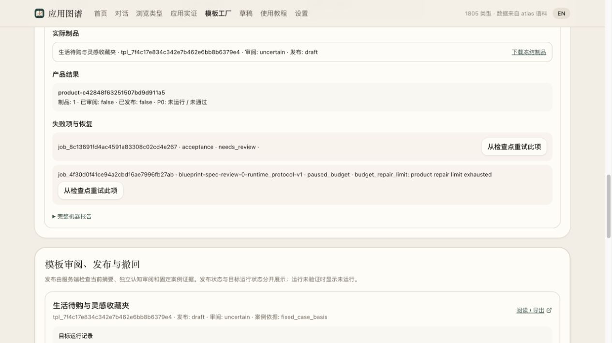

# G1 本轮真实验收报告

结论：**未通过（blocked）**。仓库检查全部通过，但真实模板修订存在产品/UI合同缺口，继续修正被每产品2轮业务修复硬上限阻止。本轮没有真实下游P0应用或运行证明；不能用历史实验或Docker fixture替代。

## 宿主正式评估

[机器评估](G1_ASSESSMENT.json)由 `BatchService.assess_g1` 读取正式案例/模板/队列/运行记录和[manifest](G1_MANIFEST.json)后持久化，不是手写passed标记。当前全部代码检查无check类阻断；实际剩余原因：

- `G1_queue_not_quiescent`
- `sample_template_not_currently_catalog_eligible`
- `sample_template_review_not_passed`
- `P0_development_delivery_checkpoint_missing`
- `P0_runtime_run_missing`
- `standard_development_export_missing`

计划已正式pause，所以队列条件未满足；实际活动调用为0，不是仍在执行或发生死锁。

## 已取得的真实证据

- 固定书签场景r2、上游完整SHA、源码快照与独立证据审阅，规范案例r1已进入共享应用实证；模板失败不删除研究。共29观察：20代码、8推断、1文档；上游运行0。
- 1个冻结候选、0个合格独立认知通过、0个正式发布、0个P0运行产品。候选独立审阅uncertain；第二轮正式局部修订仍被产品完整性/架构检查阻断。
- [限定patch和实际维度报告](g1-real-sample/repair-2/EVIDENCE_INDEX.json)。只改architecture_markdown、D04.impact；未改变feature/phase/acceptance。新版本未冻结，不声称验收程序新版本字节已验证。
- 真实页面阅读候选并导出P0包，下载归档和字段摘要一致；此候选检查不是application-development作业或开发后的P0通过。
- 新增1份case revision及其场景关联；[正式批次增量报告](G1_BATCH_REPORT.json)对app身份来源无法证明新建的部分保留classification_unknown，不把它夸大成一个新应用产品。

## 缺陷与停止点

P0 feature承诺分类重命名/删除/计数、分类内关键字检索和编辑/失败恢复；架构HTML合同只写新建等部分入口，未把这些承诺闭合。独立检查拒绝仅用JSON API代替用户入口。原始意见保留；没有通过缩小P0、删断言或重试换意见解决。

最后job `job_4f30d0f41ce94a2cbd16ae7996fb27ab` 为paused_budget，错误budget_repair_limit。42/500次可控CLI会话、active0、业务修复2/2；G1截止1792418554.633465保持，剩余总调用不能解除产品级上限。此前provider缺finish_reason的协议失败单独记录；本次最终阻断不是provider当前不可用。

## 实际检查与未运行

当前源码 `ab3fe454ce8533dec733de9c8d3ec182fdc97550f32bb79195cfea7ec5a71fb8`：后端545项（537执行通过/8已知可选skip）、webunit9、默认E2E17、工厂E2E27、严格Docker20零skip；其余规定检查通过。严格Docker是8真实Docker路径+12fixture/协议路径，非20个模型生成应用。独立执行器准备和负向fixture单列于[independent/verification](independent/verification/)，不算真实运行。

本轮P0开发、标准交接包被真实开发作业消费、实际应用归档、冻结套件对该应用运行、独立浏览器核心旅程、精确目标phase proof均未取得。故没有“完整主链真实成功样例”；提供的是完整保留的本轮失败/停止样例链。

## 首批与恢复

[T08_REPORT.json](T08_REPORT.json)为not_started。书签、月度预算、会议笔记的三场景在看结果前固定，三个均not_run；未替换、未降低门槛、未启动额外模型。

[正式恢复步骤](OPERATIONS.md)可查看原计划、预算与检查点；普通resume/retry不清零产品上限。继续业务生产需要明确的新范围/限额决策，不能自动抬高或换campaign绕过。任何新一轮仍须先取得合格模板、真正标准交接/开发和精确绑定独立运行，重新由宿主评估G1，之后才可preview/run首批。[下一批计划](NEXT_BATCH.md)保持候选性质。

## 真实页面停止点

[页面观察记录](g1-real-sample/g1-ui-observation.json)确认计划已暂停、修复额度耗尽、模板未发布及P0未运行；未点击恢复、重试或发布。

## 独立执行器最终专项（单列，不是P0）

正式V1 submission/receipt、actual app_root摘要与runtime binding、初始/重启后断言、移动/筛选负控、所有原始并发写入持久化和清理合同已修正。16项Python synthetic回归、Node合约fixture与语法检查通过，详见[准备记录](independent/verification/preparation-2026-10-19.md)；这些不包含在后端545项中，也不是实际应用通过。

实际Docker合成技术探针验证network none、零端口发布、仅宿主loopback中继到固定容器127.0.0.1、GET200、POST302原Location、同容器真实重启后仍可访问；容器和relay清理均证明完成。[探针原记录](independent/verification/network-none-relay-probe.json)明确synthetic。没有运行真实书签P0或Chromium应用旅程，没有phase proof。

[Sol最终独立静态复核](independent/verification/final-review.md)保留旧版网络P1，确认最终runner `c37db3a4aaf013fe80c43fbdcd19dcd90430e12c367c893309e21d37488df817` 的该阻断已关闭。冻结machineplan仍为 `5e352e1cdbad18d5dbf827e37e9e0f394f0e7fbf919b0dd18713f7affb6ebb3a`。执行器就绪不解除生产修复2/2和G1未通过。
